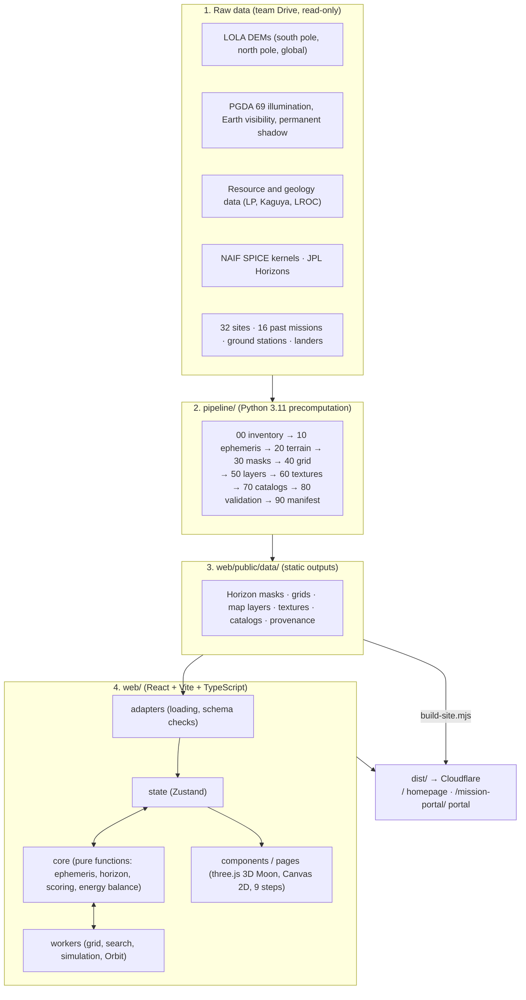

<div align="center">

# LUNA-NAV · Lunar Base Planner

**A static web app for comparing lunar south pole landing sites and dates, analyzing sunlight and Earth visibility, planning base power, and simulating surface operations, all in one place**

*NASA Space Apps Challenge 2026: "Lunar Landing Site Navigator" · Team DU:NE*

[](https://drive.google.com/file/d/1bMrFynrqyqA3BojAFyTJWUA2UwmcWBc5/view)
[](https://www.spaceappschallenge.org/2026/)
[](./LICENSE)

[](https://react.dev/)
[](https://www.typescriptlang.org/)
[](https://threejs.org/)
[](https://vite.dev/)
[](./pipeline)
[](./wrangler.jsonc)

</div>

---

## Demo Video

[](https://drive.google.com/file/d/1bMrFynrqyqA3BojAFyTJWUA2UwmcWBc5/view)

> Demo scenario: **"Launch slipped by two weeks. Is the original landing site still viable?"**
> Pick a site and date → push the date back and watch the Earth link drop → get alternative sites and dates with their differences → settle it with the comparison board and the surface operations simulation.

---

## Table of Contents

1. [Overview](#1-overview)
2. [Features](#2-features)
3. [Architecture](#3-architecture)
4. [Repository Structure](#4-repository-structure)
5. [How It Calculates](#5-how-it-calculates)
6. [Getting Started](#6-getting-started)
7. [Data Sources](#7-data-sources)
8. [Team](#8-team)
9. [License](#9-license)

---

## 1. Overview

Near the lunar south pole (roughly south of 75°S), the Sun circles only a few degrees above the horizon, so an error of less than 1° can flip a site between "sunlit" and "dark". Earth also sits low in the sky, and when nearby terrain blocks it, direct-to-Earth (DTE) communication is lost.

Existing tools such as QuickMap, Moon Trek and JPL Horizons are accurate, but it is hard for non-specialists to **quickly compare many site × date combinations**. LUNA-NAV lets you pick a site and a date and immediately shows:

- How long the Sun and Earth stay above the **real terrain horizon** (sunlit fraction, communication fraction, longest continuous darkness)
- Whether **power and communications hold up for the whole mission** under those conditions (battery, link and data volume simulation)
- When the schedule slips, alternatives split into **"same site, different date"** and **"different site, same date"**, with their differences from the original plan

Every map layer and catalog value is computed from NASA and other public observational data with verified sources; nothing is filled in with synthetic values. Where data is missing the app shows "No data", and coordinates outside the terrain data are computed with a spherical horizon (0°) and flagged "Terrain not included".

> **Scores are relative indicators for comparing candidates, not probabilities.** Geologic hazard and dust checks are **warnings** and do not guarantee safety.

---

## 2. Features

The portal follows a **9-step flow** (Design → Simulation → Review). On the right, a **3D Moon and site view** (horizon panorama, sky dome, alerts, data sources) always points at the same site and time, whatever step you are on.

| Step | Screen | What it does |
| :---: | :--- | :--- |
| **01** | Mission Setup | Choose a mission profile (long-term base, landing reconnaissance, water prospecting, custom) and lander specs (power source, power, comms, mass, thrust). These values drive the map colors and candidate ranking |
| **02** | Site & Date | Pick a site from the overall score map, the ranking table or the catalog (32 sites), or enter coordinates directly; choose a combination from the site × start date score table; see landing windows |
| **03** | Base Layout | Place landing pad, power, water mining and habitat modules; see distances between them, landing dust and fault scarp proximity warnings, and recommended solar panel spots |
| **04** | Mission Analysis | Time-lapse of battery, link and cumulative downlink from landing to end of mission; whether surface operations requirements are met; the stop point and its cause (shadow, Earth blocked, overconsumption); ground station windows (3 DSN sites + Yeoju) |
| **05** | Orbit Analysis | Compute and validate the NRHO transfer, finite burns and landing trajectory from the plan inputs in a browser Worker |
| **06** | Schedule Slip | Re-evaluate the original plan after a delay, suggest the top 3 alternatives, and show the change in score, sunlight, comms, shadow, distance and date versus the original, with a one-line reason |
| **07** | Compare | Compare 2–4 site + date combinations side by side on the same metrics; A/B scenario comparison |
| **08** | Past Missions | Replay the sky at past landings (16 missions); reference cases with similar conditions, shown with their outcome (success, partial success, failure) and cause; "Match this mission" |
| **09** | Validation | Compare our results against NASA measured illumination maps (PGDA 69, LROC WAC) and JPL Horizons |

### Map Layers

| Layer | Source data |
| :--- | :--- |
| Overall score | Relative score combining the layers below with the mission conditions (color on/off) |
| Sunlight / Earth visibility / Permanent shadow | NASA PGDA 69 average illumination, Earth visibility and permanently shadowed regions |
| Landing safety (slope) | LOLA polar DEMs, SLDEM2015 slope |
| Water ice potential | Lunar Prospector neutron hydrogen + permanent shadow ("where ice may exist", not confirmed deposits) |
| Iron / Titanium | Lunar Prospector GRS, Kaguya SP + LOLA FeO, LROC WAC TiO₂ |
| Geologic hazard | LROC fault scarps, global rockfall catalog (Bickel et al., 2020) |

The app also supports export (ranking CSV, copy report text), EN/KR switching, and a fullscreen presentation mode.

---

## 3. Architecture

A **serverless static web app**: heavy terrain computation is done ahead of time in a Python pipeline, and the browser handles everything that depends on the date, plus rendering. The same formulas exist in both Python (`luna/sky.py`) and TypeScript (`core/sky.ts`), and cross tests (`tests/fixtures/cross/`) check that they agree.



Data sources sit behind adapters, so data can be swapped without touching UI code.

| Adapter | Input → Output |
| :--- | :--- |
| `SiteCatalog` | → list of landing sites |
| `EphemerisProvider` | time, location → Sun and Earth azimuth/elevation |
| `TerrainProvider` | site → horizon mask |
| `MapLayerProvider` | layer name, region → grid values |

---

## 4. Repository Structure

```text
DU-NE-Mission-Portal-/
├── pipeline/              # Python 3.11 precomputation (Drive "DU_NE Data" → web/public/data)
│   ├── luna/              #   stages s00–s90: ephemeris, horizons, grids, layers
│   └── tests/
├── web/                   # React + Vite + TypeScript + three.js mission portal
│   ├── src/core/          #   pure calculations (ephemeris, horizon, sky, gridScore, energy, alternatives, similarity, stations …)
│   ├── src/workers/       #   grid, search and simulation Web Workers
│   ├── src/pages/         #   the 9 steps (Cond, Site, Base, Sim, Orbit, Delay, Compare, Missions, Valid)
│   ├── src/components/    #   3D Moon and Earth, south pole map, local 3D terrain, panorama and sky dome
│   ├── src/orbit/         #   Orbit (NRHO) integration
│   ├── public/data/       #   pipeline outputs (static data)
│   └── e2e/               #   Playwright integration tests
├── orbit/                 # validated Orbit source, static NASA data, regression tests
├── homepage/              # team homepage (static HTML, EN/KR)
├── scripts/               # site build (build-site.mjs) and Orbit preparation/checks
├── tests/fixtures/        # Python ↔ TypeScript cross-test inputs
├── docs/                  # architecture, decisions, validation, sources, coordinate frames
├── CLAUDE.md              # team rules and specification
├── TASKS.md               # task board
└── wrangler.jsonc         # Cloudflare Workers static deployment config
```

---

## 5. How It Calculates

| Item | Method |
| :--- | :--- |
| **Conventions** | Angles in degrees; azimuth from north 0°, increasing east. Latitude positive north, longitude positive east (−180 to 180). Times in UTC (ISO 8601). Moon-fixed frame: Mean Earth/Polar Axis, reference radius 1737.4 km |
| **Ephemeris** | Sun and Earth direction vectors are transformed into the site's local East-North-Up (ENU) frame to get azimuth and elevation. Reference values from SPICE (DE440, lunar orientation kernels), cross-checked against JPL Horizons |
| **Horizon mask** | For each azimuth step, trace a ray outward and take the maximum elevation angle. Lunar curvature corrected; high-resolution DEM for near range, low-resolution for far range |
| **Sunlight** | The Sun is treated as a disk (angular radius about 0.27°); the visible fraction above the mask is 0–1 |
| **Communication** | Earth center elevation > horizon elevation at that azimuth + communication margin (user adjustable) |
| **Ground station windows** | Intervals when the Moon is above each station's minimum operating elevation ∩ intervals when Earth is visible from the site |
| **Energy balance** | Integrate (power index × panel output − consumption) over time for the battery curve, and accumulate downlink during link intervals. Record the first time the lower limit is hit and the cause |
| **Score** | 0–100, weighted sum of power, communication and delay robustness. Weights are adjustable in the UI. If any required condition fails, the plan is marked "Requirement not met" regardless of score |
| **Reference cases** | Distance over normalized features (absolute latitude, Sun and Earth elevation at landing, time since local sunrise, mission duration) plus a penalty for differing power, comms and approach tags |

Parameters without a firm basis are marked `PROVISIONAL` and can be changed in the UI. See [`docs/params-without-basis.md`](docs/params-without-basis.md) for the list and [`docs/validation.md`](docs/validation.md) for validation results.

---

## 6. Getting Started

**Prerequisites:** Node.js 22 or later (Python 3.11 only if you rebuild the data)

### Portal + Orbit dev server

Run from the **repository root**. On Windows you can also double-click `start-dev.bat`.

```sh
npm install
npm run dev            # http://127.0.0.1:5175
```

### Tests and build

```sh
npm test               # portal type, rule and unit checks + Orbit regression tests
npm run build          # portal (web/dist) + site (dist/: homepage + /mission-portal/)
npm run preview:site   # http://127.0.0.1:5176  (homepage → Plan a landing → portal)
npm run test:e2e       # Playwright integration tests (Chrome: PLAYWRIGHT_CHANNEL=chrome)
```

### Rebuilding the data (requires the team Drive data)

```sh
cp .env.example .env.local      # LUNA_DATA_DIR=<path to DU_NE Data>
cd pipeline
python -m venv .venv && .venv\Scripts\activate   # macOS/Linux: source .venv/bin/activate
pip install -r requirements.txt && pip install -e .
python -m luna s00              # check required files and quality
python -m luna all --workers 4  # full run (resumes if interrupted)
pytest
```

Outputs are written to `web/public/data/`.

### Deployment

Cloudflare Workers (`wrangler.jsonc`) serves the `dist/` folder produced by `npm run build` as static files: `/` is the team homepage and `/mission-portal/` is the portal. No runtime server or database is needed. See [`docs/ORBIT_INTEGRATION.md`](docs/ORBIT_INTEGRATION.md) and [`docs/ORBIT_GITHUB_HANDOFF.md`](docs/ORBIT_GITHUB_HANDOFF.md) for details.

---

## 7. Data Sources

Full list with links: [`docs/data-sources.md`](docs/data-sources.md) · auto-generated table: [`docs/sources.md`](docs/sources.md)

| Area | Main datasets | Provider |
| :--- | :--- | :--- |
| Terrain | LOLA polar and global DEMs (240 m to 10 m), SLDEM2015 slope, Artemis III candidate site navigation grids | NASA GSFC / PDS Geosciences / PGDA |
| Illumination, Earth visibility, permanent shadow | PGDA 69 average illumination, Earth visibility and PSRs; LROC WAC south pole illumination; LROC NAC PSRs | NASA PGDA / ASU LROC |
| Resources | Lunar Prospector neutron and GRS, Kaguya SP + LOLA FeO, Kaguya MI, LROC WAC TiO₂ | NASA PDS / JAXA / ASU LROC |
| Geologic hazards | LROC fault scarps, global rockfall catalog, Shackleton area boulders, polar plains map | ASU LROC / open research datasets |
| Ephemeris | NAIF SPICE kernels (DE440 etc.), JPL Horizons | NASA JPL |
| Catalogs | Artemis III candidate regions (USGS, NASA), NSSDC landing site and artifact lists, LROC anthropogenic object locations, agency announcements | NASA / USGS / agencies |
| Ground stations | DSN antenna coordinates and receive horizon masks (810-005), Yeoju deep space antenna | NASA JPL DSN / KARI |
| Background imagery | LROC WAC south pole mosaic, NASA SVS CGI Moon Kit | ASU LROC / NASA SVS |

---

## 8. Team

**Team DU:NE**: six undergraduate students from four universities in and around Seoul

| Name | Affiliation |
| :--- | :--- |
| **Sanghyun Song** (Team Owner) | Software Convergence, Kyung Hee University |
| **Minjun Kwon** | Electronic Engineering, Sogang University |
| **Minjae Kim** | Physics and Mechanical Engineering, Gachon University |
| **Seoyeon Kim** | Nanomaterials Engineering, Chung-Ang University |
| **Sungjun Park** | Software Convergence, Kyung Hee University |
| **Changhyun Ha** | Mechanical Engineering, Kyung Hee University |

---

## 9. License

The code and documentation in this repository are released under the [MIT License](LICENSE).

The following are not covered by the MIT License and remain under the terms of their original sources. Sources and links are listed in [`docs/data-sources.md`](docs/data-sources.md).

- Data such as `web/public/data/`: NASA data (public domain) and USGS data (public domain). CC BY 4.0 research datasets (Wueller et al. 2026, Lemelin et al. 2022, Bickel et al. 2020, Gawronska & Boazman 2025, polar plains map) require attribution. JAXA Kaguya MI data follows the ISAS data policy.
- Images in `homepage/`: lunar base illustrations (NASA; SpaceX and Blue Origin images distributed by NASA) and university logos belong to their respective owners.
- Fonts: Pretendard, JetBrains Mono (SIL Open Font License 1.1).

<div align="center">

*Not affiliated with or endorsed by NASA.*

</div>
