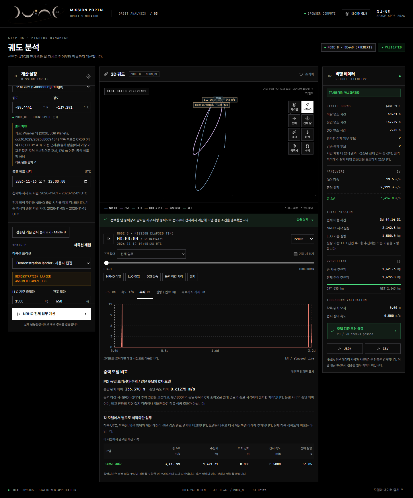
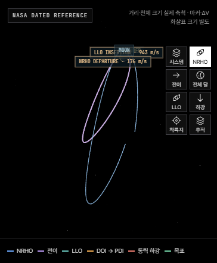

# Mission Portal UI 적용·검증 기록

2026-11-15. 대상은 로컬 `Lunar-Landing-Orbit-Simulator`뿐이다. 포탈 저장소 `DU-NE-Mission-Portal-`의 참조 커밋은 `cd38551c38dc02ccb48bc166ff812753d0a0498f`이며 참조본의 작업 트리는 변경 없이 유지했다. 이 문서는 로컬 검증 시점의 기록이다. 포탈 통합과 호스팅 배포는 수행하지 않았다.

## 디자인 근거와 변경

포탈의 `web/src/styles/base.css` **마지막에 적용되는** 2026-11-15 테마를 기준으로 했다. 파일 앞부분에 남아 있는 옛 흰색/청록 테마와 구분한다. `layout/Shell.tsx`, `components/kit.tsx`, 임무 설정의 프로파일·착륙선 정보, 임무 분석의 전력 탭, 궤도 분석 자리표시자도 확인했다. 읽기 전용 소스를 별도 Vite 설정/캐시로 미리 보았으며 포탈 소스나 패키지 파일은 수정하지 않았다.

| 요소 | 적용 |
|---|---|
| 배경 / 카드 / 보조 면 | `#000000` / `#0d0d0d` / `#111111` |
| 테두리 / 강조 테두리 | `#2c2c2e` / `#3d3d42` |
| 본문 / 설명 | `#ffffff` / `#9a9a9a` |
| 정상 / 주의 / 오류 | `#4ade80` / `#f59e0b` / `#ef4444` |
| 주요 버튼 / 선택 탭 | 흰 버튼·검정 글자 / 흰 밑줄 |
| 카드 / 모서리 | 얇은 테두리·14px 간격 / 0px |
| 본문 / 수치 | Pretendard Variable / JetBrains Mono |
| 단계 제목 | `05 궤도 분석`, 한국어 패널 제목 |

`frontend/src/portal-theme.css`는 기존 UI 구조 위에 적용되는 표시 전용 스타일이다. `App.tsx`의 제목·로고·그래프 색, `LunarScene.tsx`의 배경색도 맞췄다. 3D 경로의 단계별 색, 좌표 변환, 계산 결과와 상태 로직은 유지했다. 작은 설명/입력 글자를 키우고 좁은 화면은 한 열로 전환하며, 3D HTML 마커가 조작 버튼·대화상자를 덮지 않도록 레이어를 격리했다.

글꼴은 외부 CDN 런타임 요청 없이 정적으로 포함한다. Pretendard v1.3.9 및 JetBrains Mono v2.304의 원본 WOFF2와 SIL OFL 1.1 라이선스는 `frontend/public/fonts/`에 있다. JetBrains Mono는 Regular 파일을 사용하며 굵은 수치는 브라우저의 글꼴 처리에 따른다. 라이선스 고지를 유지한다.

- Pretendard: https://github.com/orioncactus/pretendard/tree/v1.3.9
- JetBrains Mono: https://github.com/JetBrains/JetBrainsMono/tree/v2.304
- 팀 로고: 해당 포탈 커밋의 `web/public/brand/dune-logo.png`를 변경 없이 복사했다. NASA 로고가 아니라 팀의 기존 브랜딩이다.

## 이번 검증

- `npm run build`: TypeScript 검사 및 Vite 정적 빌드 통과.
- 실제 로컬 Chrome의 20개 UI 확인 통과. 원시 요약: [portal-ui-validation.json](portal-ui-validation.json).
- 390 / 768 / 1080 / 1440 px 화면에서 페이지 가로 넘침 없음.
- Mode A 상대 시간 UI, LLO UI, 잘못된 질량의 경고·해결 안내, 차트 탭, 입력 변경 상태, 중력 모델 변경 시 결과 초기화, Worker 취소 확인.
- 수정된 화면에서 기본 Mode B를 실제 Worker로 다시 계산: **VALIDATED, 20/20 검증 항목 통과**, 궤적 6653개 표본. 기존 저장 궤적이나 테스트 모의 결과를 주입하지 않음.
- 해당 실행에서 56.597초, 접지 상대 속도 약 0.500000002 m/s. 내부 종단 위치 잔차 약 0.000001355 m는 계산기의 수치 잔차이며 실제 착륙 정확도가 아니다. 계산 예산 내 후보 2개를 평가해 2개가 검증을 통과했고, 전역 최적성을 뜻하지 않는다. 실행 시간은 이 PC의 당시 부하에 영향을 받으며 성능 보증값이 아니다.
- 콘솔 예외 0건, 시뮬레이터의 외부 런타임 네트워크 요청 0건.
- 최종 `dist`를 `/orbit/` 하위 경로에 정적으로 제공: 로고·로컬 글꼴·데이터 및 빌드된 Worker 로딩 정상, HTTP 실패 0건. 검증용 서버는 종료했다.
- `git diff`로 `frontend/src/physics/`, `defaultMission.ts`, `services/`, `workers/`, `types.ts`, `tests/`가 이전 커밋과 동일함을 확인했다. 물리 알고리즘·안전 제약·기본값을 바꾸지 않았다. 기존 독립 수치 검증 전체를 이번 표시 변경을 이유로 다시 수행하지는 않았다.

## 실제 통합 때 남은 일

현재 화면은 독립 앱이다. 포탈의 탭에 아직 연결하지 않았으며 포탈 입력을 자동으로 받지 않는다. 전역 CSS 격리, 중복 헤더 제거, 상태/Worker 전달, Three 버전 및 자산 경로 확인이 필요하다. 자세한 입력 매핑과 기본 날짜 범위 불일치는 [MISSION_PORTAL_INTEGRATION.md](MISSION_PORTAL_INTEGRATION.md)에 기록했다.
